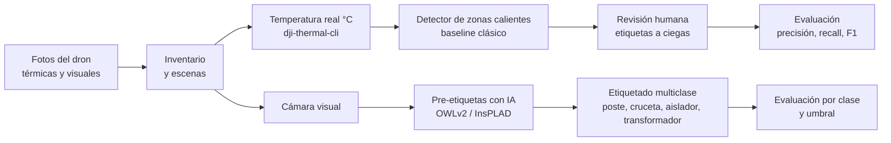

# IA en drones termográficos — Prueba de concepto para ASICAI

Prueba de concepto (PoC) en Python para **apoyar la inspección termográfica con drones** (DJI Mavic 3T): lee la temperatura real de las fotos, marca zonas más calientes que su entorno y prueba cómo reconocer postes y sus elementos con IA.
Desarrollada en una pasantía del Máster en Inteligencia Artificial (UNIR) en **ASICAI — Ingeniería y Automatización Industrial S.A.S.** (Ambato, Ecuador).

> **Alcance.** El sistema **apoya la revisión de un técnico**. **No diagnostica fallas**: un punto caliente no es una falla; eso lo decide personal calificado de ASICAI.

---

## Estado del proyecto

| Componente | Estado | Resultado medido |
|---|---|---|
| Lectura de temperatura real (°C) de fotos R-JPEG | Funciona | 170 de 170 fotos convertidas. Validación contra el programa oficial de DJI: **pendiente** |
| Detector clásico de zonas calientes (baseline) | Funciona, pero marca de más | Sobre 27 fotos revisadas a mano: precisión 0.05, recall 0.39 (IoU ≥ 0.3) |
| Mejora con filtros simples (validación cruzada por escena) | Exploratorio | F1 de 0.08 a 0.14; falsos positivos 145 → 37, recall 0.39 → 0.22 |
| Reconocer postes y elementos de línea (OWLv2, guiado por texto) | Parcial | Poste: precisión 1.00, recall 0.85 · Aislador: 0.66 / 0.67 · Cruceta: débil · Transformador: no concluyente (4 cajas) |
| Modelo público de elementos de línea (InsPLAD) | No cubre la necesidad | 17 clases de herrajes de transmisión; sin poste, cruceta ni transformador; licencia no comercial |
| Datos propios de postes | **Insuficientes** | 16 de 170 fotos (9 %), una sola estructura |

**Cómo leer estas cifras:** las etiquetas las hizo el autor (no un especialista) y **no están validadas por un técnico de ASICAI**; la muestra es pequeña (27 fotos / 18 zonas para equipos; 8 fotos de una sola estructura para postes). Son una primera medida real, **no un desempeño definitivo**. Detalle y advertencias en el informe de viabilidad.

---

## Cómo funciona



Decisiones de diseño que conviene conocer:

- **°C reales, no brillo:** las fotos usan varias paletas de color; pasar a gris no conserva el orden frío–caliente.
- **Partición por escena, no por foto:** las fotos de una misma escena son casi idénticas; mezclarlas entre entrenamiento y validación infla las métricas.
- **Etiquetado a ciegas:** si se parte de las cajas del detector, su evaluación sale optimista.
- **Clase "dudoso":** los objetos que nadie sabe nombrar no cuentan como acierto ni como error.
- **Detector aislado** (`src/hotspot_detector.py`): se puede reemplazar o combinar con un modelo entrenado sin tocar el resto del flujo.

---

## Requisitos e instalación

- Python 3.13 (probado con 3.13.7) en Windows; los comandos de ejemplo usan PowerShell.
- No se necesita GPU para nada de lo que contiene este repositorio.

```powershell
python -m venv venv
(Set-ExecutionPolicy -Scope Process -ExecutionPolicy RemoteSigned) ; (& .\venv\Scripts\Activate.ps1)
pip install -r requirements.txt
pip install -r requirements_extra.txt
```

Paquetes opcionales, solo para lo que se quiera probar: `onnxruntime huggingface_hub` (modelo InsPLAD), `torch transformers scipy` (OWLv2), `ultralytics` (entrenar YOLO).

---

## Inicio rápido

### 1. Demo con datos sintéticos (sin fotos reales)
```powershell
python run_demo.py
```
Genera escenas térmicas sintéticas con verdad conocida, detecta puntos calientes, evalúa y guarda imágenes anotadas, un CSV y las métricas. Los experimentos están en `experimentos.ipynb`.

### 2. Comprobar que todo funciona
```powershell
python tests\test_pipeline.py      # debe terminar en: TODO OK
python tests\test_multiclass.py    # debe terminar en: MULTICLASE OK
```
Las pruebas usan datos falsos: no leen ni modifican fotos reales.

### 3. Con fotos reales del Mavic 3T
Reemplaza `<fotos>` por la carpeta con las fotos (fuera del repositorio).
```powershell
# Temperatura real
dji-thermal-cli process --input-dir "<fotos>" --output-dir data\real_private\temp_c_tiff -o temp_c:tiff

# Inventario, escenas y baseline
python src\real_baseline.py --root "<fotos>" --out data\real_private --temp-dir data\real_private\temp_c_tiff
python src\scene_catalog.py --out data\real_private

# Zonas calientes: etiquetado a ciegas, repartido por escena, y evaluación
python src\review_labels.py --out data\real_private --blind --per-group 1
python src\eval_real.py --out data\real_private --pred-dir data\real_private\labels_pre
python src\sweep_baseline.py --out data\real_private

# Postes y elementos de línea (cámara visual)
python src\zero_shot_owl.py --out data\real_private --scene 9
python src\review_multiclass.py --out data\real_private --scene 9 --limit 8
python src\eval_owl_vs_labels.py --out data\real_private
```
Guías paso a paso: [`docs/GUIA_ETIQUETADO_TERMICO.md`](docs/GUIA_ETIQUETADO_TERMICO.md) y [`docs/GUIA_CONTINUIDAD.md`](docs/GUIA_CONTINUIDAD.md).

---

## Datos y confidencialidad

Las fotos son de **clientes de ASICAI**. Reglas del proyecto:

- Las fotos y todo lo derivado (temperaturas, etiquetas, resultados con imágenes) viven en `data/real_private/`, **que el `.gitignore` excluye**.
- Todo el procesamiento es **local**. No subir fotos a servicios en la nube ni a chats sin autorización escrita de ASICAI.
- Los notebooks ejecutados guardan las imágenes dentro del archivo: limpiar salidas antes de cada commit (`pip install nbstripout`, luego `nbstripout resultados_reales.ipynb`).
- Los pesos de modelos (`models/`) no se versionan: son pesados y algunos son de uso no comercial.

---

## Estructura del repositorio

```
asicai-poc/
├── README.md
├── requirements.txt / requirements_extra.txt
├── run_demo.py                     demo con datos sintéticos
├── experimentos.ipynb              experimentos con datos sintéticos
├── resultados_reales.ipynb         resultados con fotos reales (limpiar salidas antes de commit)
├── src/
│   ├── thermal_simulator.py        escenas sintéticas con verdad conocida
│   ├── hotspot_detector.py         detector baseline (visión clásica)
│   ├── evaluate.py                 métricas del flujo sintético
│   ├── real_data.py                inventario, escenas y lectura térmica (°C)
│   ├── real_baseline.py            baseline sobre fotos reales y pre-etiquetas
│   ├── real_tools.py               utilidades para el notebook de fotos reales
│   ├── review_labels.py            etiquetado de zonas calientes (local)
│   ├── eval_real.py                evaluación del baseline contra etiquetas
│   ├── sweep_baseline.py           mejora exploratoria con validación cruzada por escena
│   ├── scene_catalog.py            catálogo de qué contiene cada escena
│   ├── zero_shot_owl.py            pre-etiquetas con OWLv2 (guiado por texto)
│   ├── transfer_insplad.py         prueba con modelo público InsPLAD
│   ├── review_multiclass.py        etiquetado multiclase de postes (local)
│   ├── eval_owl_vs_labels.py       evaluación por clase y umbral
│   ├── labels_multi.py, yolo_io.py utilidades de etiquetas
│   ├── make_yolo_dataset.py        dataset YOLO por escena (si se entrena)
│   ├── train_yolo.py               fine-tuning de YOLO (preparado, no ejecutado)
│   └── gsd.py                      tamaño del píxel según la distancia de vuelo
├── tests/                          pruebas de humo con datos falsos
├── data/
│   ├── sample_images/ , output/    demo sintética
│   └── real_private/               CONFIDENCIAL — fuera de git
└── docs/                           guías, plan e informes (ver abajo)
```

---

## Documentación

| Documento | Para qué sirve |
|---|---|
| [`GUIA_CONTINUIDAD.md`](docs/GUIA_CONTINUIDAD.md) | Cómo seguir el trabajo: flujo, decisiones, licencias, siguientes pasos |
| [`GUIA_CAPTURA.md`](docs/GUIA_CAPTURA.md) | Protocolo de captura propuesto para fotos nuevas (borrador a validar) |
| [`GUIA_ETIQUETADO_TERMICO.md`](docs/GUIA_ETIQUETADO_TERMICO.md) | Cómo etiquetar zonas calientes con un criterio constante |
| [`PROPUESTA_CLASES_LINEAS.md`](docs/PROPUESTA_CLASES_LINEAS.md) | Lista propuesta de elementos de postes y líneas para validar con ASICAI |
| [`PLAN_CIERRE.md`](docs/PLAN_CIERRE.md) | Plan de trabajo y correcciones a resultados anteriores |
| `ARCHITECTURE.md`, `RESULTADOS.md`, `NEXT_STEPS.md` | Documentos del primer sprint (datos sintéticos) |

El **informe técnico de viabilidad** y los **informes de avance** se entregan aparte a ASICAI y a UNIR.

---

## Limitaciones conocidas

- Pocas fotos y poco variadas: 14 escenas; solo 16 fotos de postes, de una sola estructura (ASICAI informó que no dispone de más) [confirmar por escrito].
- Etiquetas del autor, sin validar por un técnico; el criterio de "zona de interés" debe definirlo ASICAI.
- Los °C absolutos son orientativos: todas las fotos conservan los parámetros por defecto (distancia 2.5 m, emisividad 0.95, ambiente y reflejada 25 °C) y el telémetro no dio lectura en 160 de 170 fotos.
- Las crucetas son piezas diagonales difíciles de encerrar con rectángulos; para conductores y mediciones finas haría falta segmentación.
- Medir la temperatura de un conductor delgado exige volar muy cerca (a 10 m, un cable de 2 cm [supuesto] ocupa ~1.4 píxeles).

## Licencias de terceros (revisar antes de un uso comercial)

| Componente | Licencia | Nota |
|---|---|---|
| Datos y modelo InsPLAD | No comercial | Solo investigación y prácticas |
| OWLv2 (Google) | Apache 2.0 | Verificada en la tarjeta del modelo |
| dji-thermal-cli | AGPL-3.0 | Paquete de terceros, reciente; validar y revisar con criterio legal |
| Ultralytics YOLO | [verificar] | Según se tiene entendido, AGPL con licencia comercial aparte |

Licencia del código de este repositorio: **[por definir con ASICAI y UNIR]**.

## Próximos pasos

1. ASICAI valida la lista de elementos de línea y el significado de "380".
2. Captura nueva de postes con el protocolo de `docs/GUIA_CAPTURA.md`.
3. Pre-etiquetar con OWLv2, corregir a mano y medir el tiempo por foto (referencia propia: ~6 min por foto).
4. Un técnico valida el criterio y una muestra de etiquetas.
5. Entrenar un detector propio y medirlo por escena.
6. Relacionar cada elemento detectado con su zona en la imagen térmica.

## Autoría

**Christian Masaquiza Jerez** — Máster en Inteligencia Artificial, UNIR.
Tutor de prácticas (empresa): Ing. Andrés Álvarez, Gerente General, ASICAI.
Contacto: [completar].
